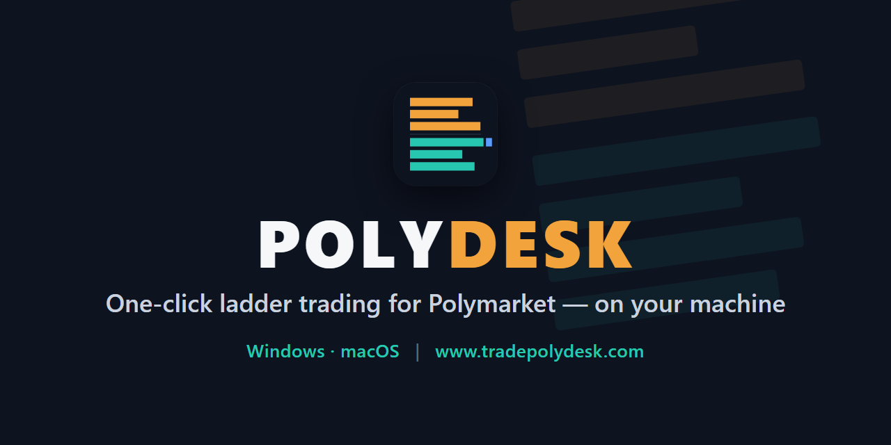

<p align="center">
  
</p>

# POLYDESK clicktrader: ladder trading desktop app for Polymarket

**Website: [www.tradepolydesk.com](https://www.tradepolydesk.com)**

[](https://github.com/itereon-dev/polydesk-clicktrader-releases/releases/latest)

POLYDESK clicktrader is a desktop trading cockpit for [Polymarket](https://polymarket.com).
You get a one-click price ladder like the ones on exchange trading tools, and a Grid view that
shows all outcomes of a market at once. Take and cancel with one click, switch stake presets
from the keyboard, see your hedge and cash-out figures, and keep track of positions and P&L.
It's made for traders who would rather click a price than fill in a form.

The app runs on **your** computer. Your key and your funds never touch our servers, and nobody
places orders for you. POLYDESK is independent software made by itereon GmbH. It is **not
affiliated with or endorsed by Polymarket**.

> **Open beta.** POLYDESK is in public beta and changes quickly, so features and limits can
> differ between releases. While the beta runs, every installation gets all **Plus** features
> with no builder fee. We'll announce the end of the beta at least 30 days ahead, on the website
> and in the app.

This repository is where you download POLYDESK and get support. The app is closed source, so
you won't find code here. You'll find the releases, checksums, and a place for questions and
bug reports.

---

## What's in the cockpit

- **Ladder:** one outcome with full depth, in the columns HEDGE, ASK, price, BID and MINE. Click
  an ASK cell to buy right away, click a BID cell to rest a buy order. Your resting orders show
  as blue MINE chips: click one to cancel it, drag it to move it. A click on the price column
  recenters the ladder. The ladder follows the mid price on its own, and the price bar on its
  edge shows the whole book, so a fast market doesn't run off the screen.
- **Grid:** every outcome of a market on one row. Ask cells on the left, your size in the
  middle, bid cells on the right, with 4 to 12 levels per side. A click stages the order in the
  PLACE BETS ticket, and it goes out when you confirm it there.
- **Hedging and cash-out:** the HEDGE column shows what you would make or lose by closing at
  each price, across all outcomes of the market. Press **F** to hedge every position at the best
  bid.
- **Keyboard:** stake presets on **1** to **8**, **Space** arms and disarms, **F** hedges,
  **Esc** cancels every working order.
- **Everything in view:** positions, working orders, the fills log and session figures sit in
  the bottom panel. Engine and price feed status are in the footer.
- **Paper mode:** the full cockpit on live market data with simulated fills. It's free, has no
  time limit and needs no wallet or funds.
- **Armed / disarmed:** the engine always starts disarmed and nothing is sent until you arm it.
  **Esc** or **CANCEL ALL** pulls all your working orders at once.

Guides on the website: [tutorial](https://www.tradepolydesk.com/tutorial),
[ladder trading](https://www.tradepolydesk.com/ladder-trading),
[the Grid](https://www.tradepolydesk.com/grid-trading),
[learn](https://www.tradepolydesk.com/learn),
[FAQ](https://www.tradepolydesk.com/faq),
[changelog](https://www.tradepolydesk.com/changelog).

---

## Download

These links always point to the **current stable version**:

| System | Download | Versioned file name on the release page |
|---|---|---|
| **Windows 10 / 11** (64-bit) | [polydesk-windows-x64-setup.exe](https://github.com/itereon-dev/polydesk-clicktrader-releases/releases/latest/download/polydesk-windows-x64-setup.exe) (recommended) | `polydesk_<version>_x64-setup.exe` |
| Windows, for IT-managed installs | [polydesk-windows-x64.msi](https://github.com/itereon-dev/polydesk-clicktrader-releases/releases/latest/download/polydesk-windows-x64.msi) | `polydesk_<version>_x64_en-US.msi` |
| **macOS** on Apple Silicon (M1 or newer) | [polydesk-macos-arm64.dmg](https://github.com/itereon-dev/polydesk-clicktrader-releases/releases/latest/download/polydesk-macos-arm64.dmg) | `polydesk_<version>_aarch64.dmg` |
| Checksums | [SHA256SUMS.txt](https://github.com/itereon-dev/polydesk-clicktrader-releases/releases/latest/download/SHA256SUMS.txt) | |

Older versions and the release notes are on the
**[Releases](https://github.com/itereon-dev/polydesk-clicktrader-releases/releases)** page. Each
release has every installer twice, under the fixed name above and under a versioned name. Both
files are identical.

There are no builds for Intel Macs or Linux. Pre-releases (`-beta`) are marked as such and the
links above never point to them. Only install one if we asked you to help test it.

### Installing

Windows installers are code-signed by **itereon GmbH**. macOS builds aren't signed yet, so macOS
warns you on the first launch. That's expected and doesn't mean the download is broken. On both
systems, **verify the checksum first** (see below), then:

- **Windows:** double-click the `.exe`. SmartScreen can still show *"Windows protected your PC"*
  while a new release builds up reputation. Check that the dialog names **itereon GmbH** as the
  publisher, then click **More info** and **Run anyway**.
- **macOS:** open the `.dmg` and drag **polydesk** into *Applications*. On the first launch,
  Gatekeeper says *"polydesk.app is damaged and can't be opened"*. The app isn't damaged; that's
  how macOS reports the quarantine flag on an unsigned app. Run this once in Terminal, then open
  the app as usual:

  ```bash
  xattr -cr /Applications/polydesk.app
  ```

### Verify your download

Every release includes a `SHA256SUMS.txt` that our build pipeline creates from the published
files. It lists both the fixed and the versioned file names, with the same hash. Compare the line
for your file with the hash of what you downloaded:

```powershell
# Windows (PowerShell)
Get-FileHash .\polydesk-windows-x64-setup.exe -Algorithm SHA256
```

```bash
# macOS (Terminal)
shasum -a 256 ~/Downloads/polydesk-macos-arm64.dmg
```

If the hash doesn't match, delete the file and download it again, from this page only.

---

## First start

1. **A short setup guide opens.** It asks you to accept the disclaimer and the Terms of Use, then
   walks you through the cockpit. You can open it again any time from the account menu (top
   right) → *Setup guide…*.
2. **You start in paper mode.** The trading engine is built into the app and runs in paper mode
   without any setup: no wallet, no funds, no purchase. Paper fills are simulated against the
   real order book, so you can practice one-click entry and cancelling without risking anything.
3. **Going live** takes two steps. Store your wallet key in **⚙ Settings → ACCOUNT** (or in the
   setup guide), then switch the **PAPER / LIVE** pill in the top bar. Use a wallet you keep
   only for trading and only put in what you can afford to lose. Never import your main wallet.
4. **The manual** opens from **? GUIDE** in the footer. It covers every part of the cockpit:
   markets, ladder, Grid, stakes, the ticket, hedging, positions, display formats and shortcuts.

## Plans

| | **Free** | **Plus** | **Pro** |
|---|---|---|---|
| Price | €0, no licence | flat, monthly or yearly, *price to be announced* | on request |
| Trading | paper **and** live | paper and live | paper and live |
| Risk caps | $25 stake · $100 exposure per market · 5 open orders per market | set your own | set your own |
| Ladders | one at a time | Grid with unlimited ladders | unlimited |
| Session stats | current trading day | all sessions | all sessions |
| Builder fee | none | none | none |
| Support | GitHub | priority by email | priority by email |
| Setup | local | local, licence bound to one of your wallets | set up once on your own server |

Live trading is part of Free, so you don't have to buy anything to place a real order. The Free
caps are provisional beta values and only apply after the beta. **Until then, every installation
runs with all Plus features and no builder fee.** Plus will first be available in selected
billing countries. Pro is only offered in unrestricted jurisdictions, with the server in your own
country. Current details are on the [pricing page](https://www.tradepolydesk.com/#pricing).

## How your key and funds are protected

- **Non-custodial.** Your wallet key is stored on your machine, encrypted in your operating
  system's keychain (macOS Keychain or Windows Credential Manager). It's never kept in a plain
  file and never sent anywhere. The engine inside the app signs orders on your device, and no
  POLYDESK server sits between you and Polymarket. We can't access, move or freeze your funds.
- **Risk caps.** Maximum stake per order, maximum open orders and maximum exposure per market are
  enforced by the engine itself, not just by the interface.
- **Kill switch.** The engine starts **disarmed**. Disarming blocks new orders at once, and
  **CANCEL ALL** or **Esc** cancels every working order.
- **No credentials in the releases.** Anything personal is entered by you after installing and
  stays on your device.

## Requirements

- Windows 10/11 (64-bit), or macOS on Apple Silicon.
- For live trading: a Polymarket account that you set up and funded yourself, and its private
  key, which you store in POLYDESK. Paper mode needs neither.
- An internet connection **from a country where Polymarket allows trading**. Polymarket decides
  this based on your connection, not the app. In restricted regions you may only be able to
  close positions. Don't use a VPN or proxy to get around this: it breaks Polymarket's terms and
  can cost you your account. It's your responsibility to check that your use is legal where you
  are.

## Updates

POLYDESK updates itself. Shortly after launch it checks this repository for a new version and
shows an **⬆ UPDATE** button in the footer when one is available. Every update is
cryptographically verified before it installs, so it can only come from us. To check by hand,
open the account menu → *About* → *CHECK FOR UPDATES*. Beta builds come out often; we recommend
updating between sessions, not while orders are working.

## Privacy

The app runs locally and talks directly to Polymarket's public services for markets, prices and
your positions, and to GitHub to check for updates. We collect **no usage telemetry and no
trading data**: no orders, positions, market data or wallet information. When something crashes,
the app sends an anonymous error report so we can fix it, and it counts its own starts and
crashes per version without any identifier. Neither contains keys, balances or trading data. From
v0.5.6 you can switch the error reports off in ⚙ Settings. More in the
[privacy policy](https://www.tradepolydesk.com/privacy) and in the in-app manual.

## Help, questions, bug reports

- **Bugs:** [open an issue](https://github.com/itereon-dev/polydesk-clicktrader-releases/issues/new/choose).
  The form asks for your version (account menu → *About*), your system, the trading mode and the
  entries from the 🔔 notification log. Before you report, check that the footer shows
  **ENGINE READY** and **PRICES LIVE** and that you're on the latest release. **Never post private
  keys, API tokens or wallet addresses**, and remove them from logs and screenshots before you
  upload anything.
- **Questions and how-to:** [Discussions → Q&A](https://github.com/itereon-dev/polydesk-clicktrader-releases/discussions/categories/q-a)
- **Ideas:** [Discussions → Ideas](https://github.com/itereon-dev/polydesk-clicktrader-releases/discussions/categories/ideas)
- **Release news:** [Discussions → Announcements](https://github.com/itereon-dev/polydesk-clicktrader-releases/discussions/categories/announcements),
  the [releases](https://github.com/itereon-dev/polydesk-clicktrader-releases/releases) themselves,
  and [@tradepolydesk](https://x.com/tradepolydesk) on X.
- **Licensing, billing, privacy, Pro setup:** office@itereon.eu, see also the
  [support page](https://www.tradepolydesk.com/support).
- **Security issues:** please report them privately, see [SECURITY.md](SECURITY.md).

## Disclaimer

> POLYDESK is trading software you install and run yourself, on your own device or
> server. It is non-custodial: your keys and funds never leave your control, and we
> never place orders on your behalf or operate the software for you. It connects to
> third-party platforms with which we are not affiliated and by which we are not
> endorsed. Availability and legality vary by jurisdiction: confirming that your use
> is permitted where you are, and complying with each platform's terms, is your
> responsibility. The software must not be used to circumvent any platform's access
> restrictions. Trading involves risk of loss; nothing here is financial advice; the
> software is provided as-is, without guarantee of execution, latency, uptime or data
> accuracy.

## Legal

© 2026 itereon GmbH, Vienna. All rights reserved. POLYDESK is proprietary software. Its use is
governed by the [Terms of Use](https://www.tradepolydesk.com/terms), which you accept in the
setup guide on first start. Polymarket is a trademark of its respective owner and is named here
for descriptive purposes only. The licence notices for the open-source components POLYDESK is
built with ship inside the app (*About → Third-party licenses*).
